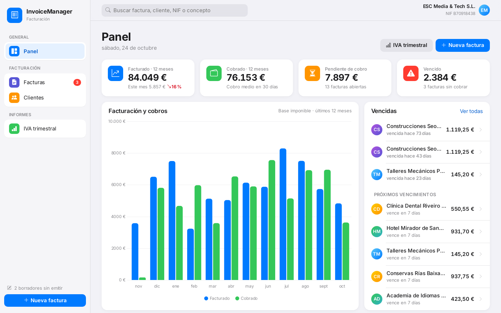
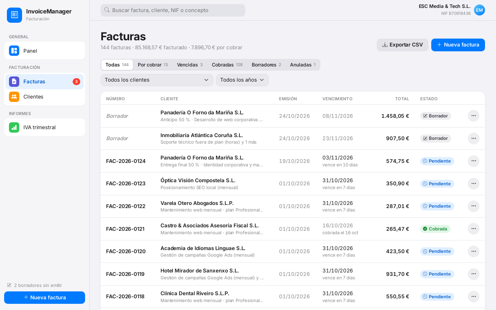
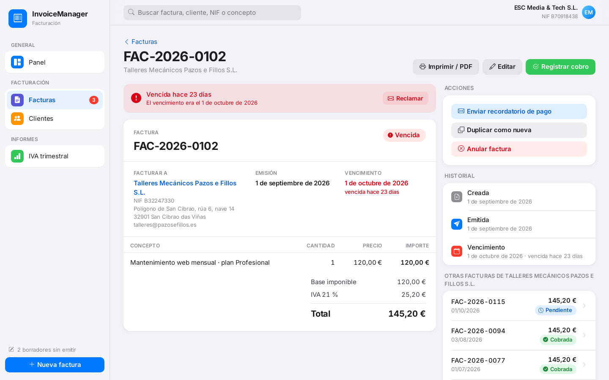
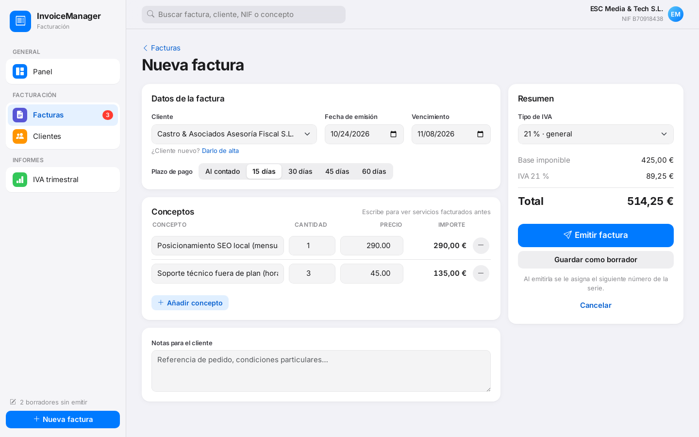
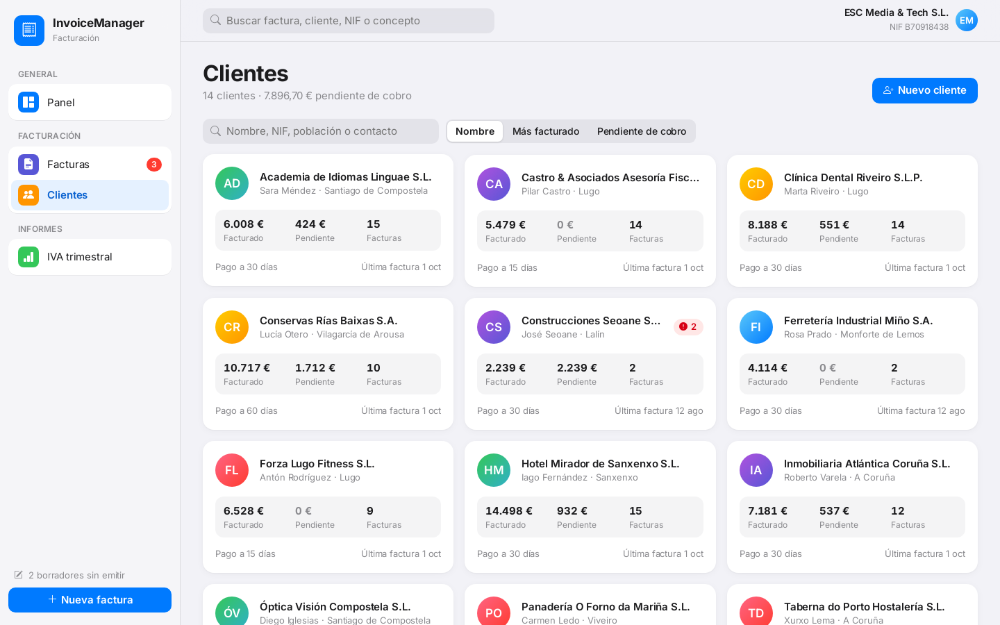
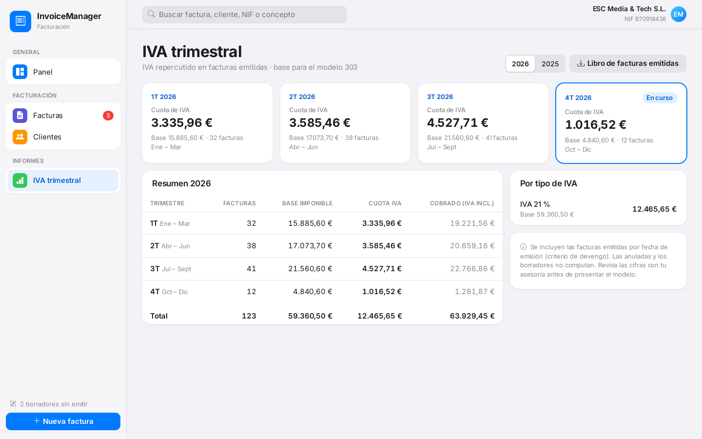
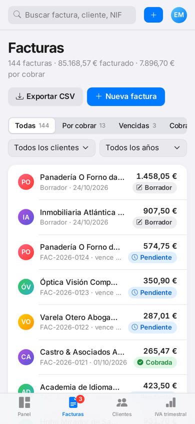

# Invoice Manager

Invoicing app for a small Spanish company, built with **ASP.NET Core 8 MVC**, Entity Framework Core and SQLite.

It covers the full life of an invoice the way a small business actually works: drafts, a correlative numbering series, issuing, collecting payments, cancelling, and the quarterly VAT summary for the accountant.

**Live demo:** https://invoicemanager-67f4.onrender.com (free plan: the first visit may take ~30 s to wake up)



---

## Features

### Invoices
- **Draft → issued → paid / overdue / cancelled** workflow
- **Correlative numbering per year** (`FAC-2026-0001`), assigned only when an invoice is issued, so drafts never leave gaps in the series
- Issue date cannot go backwards in the series; issued invoices cannot be deleted, only cancelled (the number is kept)
- Line editor with live totals, payment-term shortcuts (cash, 15, 30, 45, 60 days) and **autocomplete of previously billed services** with their last price
- Spanish VAT rates (21 %, 10 %, 4 %, 0 %) and commercial rounding
- **Register payment** with date and method (bank transfer, SEPA direct debit, card, Bizum, cash), undo payment
- **Duplicate** an invoice to bill recurring services
- **Payment reminder** by email with the amount, due date and IBAN prefilled
- Printable A4 invoice / PDF with the company's tax details
- Filters by status, client and year, full-text search (number, client, tax ID, line description) and **CSV export** ready for Spanish Excel

### Clients
- Tax ID validation (**NIF, NIE and CIF** with check character) and duplicate detection
- Default payment terms per client, used to compute due dates
- Per-client figures: invoiced, collected, outstanding, overdue and **average days to pay**
- Clients with invoices cannot be deleted

### Reports
- Dashboard: invoiced and collected over the last 12 months, outstanding and overdue amounts, upcoming due dates, top clients
- **Quarterly VAT summary** (support for form 303) and the issued-invoices ledger as CSV

### Interface
- iOS-inspired design on Bootstrap 5 and Bootstrap Icons, grouped cards, segmented controls and status pills
- Mobile layout with a bottom tab bar

| Invoices | Invoice | New invoice |
|---|---|---|
|  |  |  |

| Clients | Quarterly VAT | Mobile |
|---|---|---|
|  |  |  |

---

## Tech stack

- ASP.NET Core 8 MVC, Razor views and tag helpers
- Entity Framework Core 8 with SQLite
- Bootstrap 5.3, Bootstrap Icons, Chart.js
- Docker, deployed on Render
- GitHub Actions: build, Docker image, functional audit and screenshots

## Project structure

```text
Controllers/   Home (dashboard), Invoices, Clients, Reports
Models/        Client, Invoice, InvoiceLine, view models, company settings
Services/      Numbering series, overdue status, NIF/CIF validation, CSV, formatting
Data/          DbContext and demo data seeder
Views/         Razor views (shared invoice and client forms)
.github/       CI workflow, functional audit and screenshot scripts
```

## Demo data

On first start the database is seeded with 14 fictional clients from Galicia (valid CIFs), monthly retainers, projects billed as 50 % deposit + 50 % on delivery, yearly hosting renewals, two drafts and one cancelled invoice. Each client pays differently (early, on time, late), so the dashboard shows realistic overdue invoices. All dates are relative to today.

The issuing company and its tax details are configured in `appsettings.json` (`Company` section).

## Run locally

```bash
dotnet run
```

## Run with Docker

```bash
docker build -t invoicemanager .
docker run -p 8080:8080 invoicemanager
```

## Quality checks

Every push runs `.github/scripts/audit.py` against the Docker container. It opens every invoice, printable invoice and client page, and runs the full workflow with real antiforgery tokens:

- create, edit, issue, pay, undo payment, cancel and delete drafts
- validations: client, due date, empty lines, tax ID, numbering order
- the numbering series has no gaps
- CSV formats are checked

---

## Author

**Elizabeth Sáenz** · Full Stack & AI Engineer
